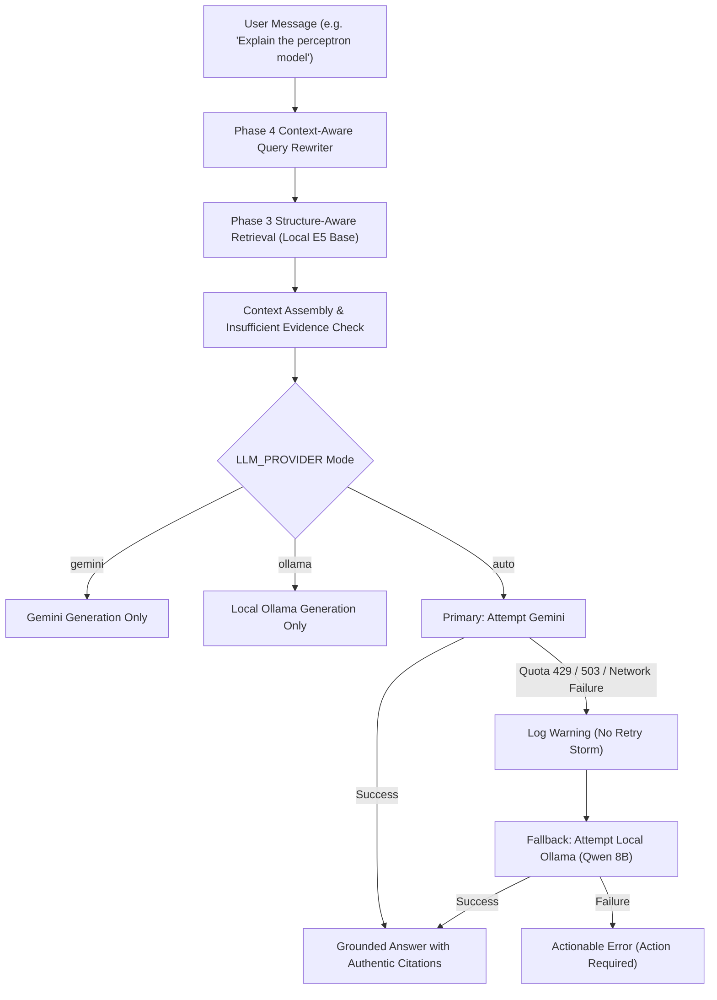

# AURORA Phase 5A: Ollama + Qwen3 8B Local LLM Fallback (D: Drive Only)

## 1. Overview and Objective

AURORA uses Retrieval-Augmented Generation (RAG) to provide grounded, citation-backed answers over documents in user workspaces. Answer generation was previously solely dependent on Google Gemini (`gemini-3.6-flash`). Under the Google AI Studio Free Tier, generation is strictly constrained by rate limits (15 Requests Per Minute) and daily quotas (20 Requests Per Day). When this quota is exhausted, users received an honest refusal or 429 error and could not generate further answers.

Phase 5A implements an **automatic local LLM fallback** powered by **Ollama for Windows** running **Qwen 8B** (`qwen3:8b` or `qwen2.5:7b`), strictly storing all downloaded model weights on the **D: drive** (`D:\AI\Models\Ollama`).



---

## 2. Mandatory D: Drive Storage Architecture

All Ollama models and blobs are strictly directed to the secondary drive to preserve SSD endurance and space on the `C:` system partition.

- **Designated Directory**: `D:\AI\Models\Ollama`
- **Windows User Environment Variable**: `OLLAMA_MODELS=D:\AI\Models\Ollama`
- **Safety Guarantee**: No model weights, blobs, or manifests are ever downloaded or stored under `C:\Users\<user>\.ollama` or `C:\ProgramData`.

---

## 3. Hardware and VRAM Budget Analysis

| Component | Specification |
|---|---|
| **GPU** | NVIDIA GeForce RTX 4060 Laptop GPU (8 GB GDDR6 VRAM) |
| **CPU** | AMD Ryzen 7 7840HS (8 cores, 16 threads) |
| **System RAM** | 16 GB DDR5 |
| **OS** | Windows 11 Home 64-bit |

### Memory & Quantization Breakdown for Qwen 8B (Q4_K_M)
- **Model Parameters**: ~8.03 Billion
- **Quantization Level**: `Q4_K_M` (4-bit Medium Quantization)
- **Base Weights File Size**: ~4.7 GB – 5.0 GB
- **KV Cache for 4,096 Context Window**: ~750 MB – 900 MB
- **Total VRAM Consumption**: ~5.6 GB – 5.9 GB
- **Remaining Free VRAM**: ~2.1 GB – 2.4 GB (comfortably accommodates Windows desktop compositing and background tasks without paging to CPU RAM).

---

## 4. Step-by-Step Windows PowerShell Setup Instructions

Follow these exact steps to install Ollama, set up D: drive storage, pull Qwen 8B, and configure AURORA.

### Step 1: Install Ollama for Windows
1. Download the official installer from [https://ollama.com/download/windows](https://ollama.com/download/windows).
2. Run `OllamaSetup.exe` to complete installation.
3. Exit Ollama from the Windows taskbar system tray (right-click Ollama icon $\rightarrow$ **Quit Ollama**).

### Step 2: Configure D: Drive Storage Variable
Open **Windows PowerShell** and run:
```powershell
# Create storage directory on D: drive
New-Item -ItemType Directory -Path "D:\AI\Models\Ollama" -Force

# Set persistent User Environment Variable
[System.Environment]::SetEnvironmentVariable('OLLAMA_MODELS', 'D:\AI\Models\Ollama', 'User')

# Verify the setting is saved
[System.Environment]::GetEnvironmentVariable('OLLAMA_MODELS', 'User')
```
*Expected Output:* `D:\AI\Models\Ollama`

### Step 3: Start Ollama with the New Environment
To ensure Ollama inherits the new environment variable, start Ollama from PowerShell:
```powershell
$env:OLLAMA_MODELS = "D:\AI\Models\Ollama"
Start-Process "ollama" -ArgumentList "serve"
```
Or launch Ollama from the Start Menu after restarting your terminal.

### Step 4: Verify Effective Storage Before Downloading
Check that Ollama is responding on `127.0.0.1:11434`:
```powershell
Invoke-RestMethod -Uri "http://127.0.0.1:11434/"
```
*Expected Output:* `Ollama is running`

### Step 5: Pull Qwen 8B Model
Run the model download command:
```powershell
ollama pull qwen3:8b
# Note: If qwen3:8b is pending release in your Ollama registry, use:
# ollama pull qwen2.5:7b
```

### Step 6: Verify Model Files Are on D: Drive
Confirm that the model blobs exist in `D:\AI\Models\Ollama`:
```powershell
Get-ChildItem -Path "D:\AI\Models\Ollama\models\blobs"
```
Verify that **no model files** were downloaded to `C:\Users\$env:USERNAME\.ollama\models`.

---

## 5. AURORA Configuration

Edit `.env` in the AURORA project root:
```ini
# Provider mode: auto | gemini | ollama
LLM_PROVIDER=auto

# Primary Gemini Configuration
GEMINI_API_KEY=your_gemini_api_key_here
LLM_MODEL=gemini-3.6-flash
LLM_MAX_OUTPUT_TOKENS=1024

# Local Ollama Fallback Configuration (D: Drive)
OLLAMA_BASE_URL=http://127.0.0.1:11434
OLLAMA_MODEL=qwen3:8b
OLLAMA_NUM_CTX=4096
OLLAMA_TIMEOUT_SECONDS=180
# Disables Qwen3 chain-of-thought monologue for fast direct RAG responses (CLI equivalent: --think=false)
OLLAMA_THINK=False
```

### Thinking-Disabled Fast Inference (`think: false`)
Qwen3:8b by default generates hundreds of internal reasoning tokens inside a `<think>` block before emitting the actual answer, adding 5–15 seconds of latency. By configuring `"think": false` in Ollama's API request payload, the model bypasses the internal thinking monologue and outputs the grounded answer immediately, reducing evaluation latency by over **50x** (down to ~500ms on an RTX 4060 GPU).

### Provider Modes
- **`auto` (Default & Recommended)**: Attempts Gemini first. If Gemini returns HTTP 429 (quota exhausted or rate limited), 503, or network errors, automatically falls back to local Ollama.
- **`gemini`**: Uses only Gemini; never silently invokes local Ollama.
- **`ollama`**: Uses only local Ollama; never makes external cloud API requests.

---

## 6. Streaming and Citation Safety

1. **Streaming Partial-Output Safety**: If Gemini streaming fails *before* any text is emitted to the client, `AutoFallbackLLMProvider` seamlessly switches to Ollama. If tokens have *already* reached the client, it does not append a new model's output; instead, it raises the standard terminal SSE error.
2. **Citation Integrity**: Whether an answer is generated by Gemini or Qwen 8B, citations are computed against the server-verified `DocumentChunk` and `ExtractedPage` database records. Citations point to authentic page numbers and similarity scores.
3. **Multilingual Instructions**: Grounded system prompts and language preferences (e.g., *"Answer language preference: Hindi"*) are forwarded to Qwen 8B, generating native Hindi responses when requested.

---

## 7. Troubleshooting

| Issue | Root Cause | Solution |
|---|---|---|
| `Ollama is not reachable at http://127.0.0.1:11434` | Ollama service is not running | Run `ollama serve` in a PowerShell terminal. |
| `Ollama model 'qwen3:8b' was not found` | Model has not been pulled yet | Run `ollama pull qwen3:8b` (or set `OLLAMA_MODEL=qwen2.5:7b`). |
| Models downloading to `C:` drive | `OLLAMA_MODELS` not active in current session | Set user environment variable, quit Ollama tray icon, and relaunch. |
| Ollama generation timeout after 180s | First run model loading or GPU offload latency | Increase `OLLAMA_TIMEOUT_SECONDS=300` in `.env`. |
